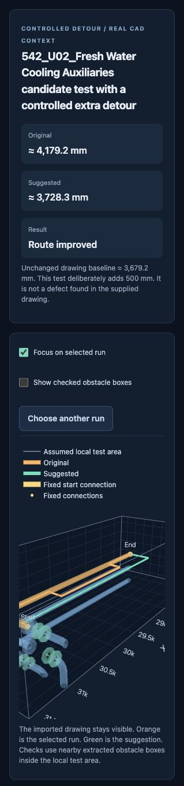

# Maritime Dual Use Hackathon 2026

We picked Track 2. We are building a tool that checks existing ship piping and suggests better routes while keeping pipe sizes and connection points fixed.

**Current status on October 17:** the simple line workflow has run inside AutoCAD on the Snapdragon laptop. The team saved green review centerline `82` on `MARITIME_SUGGESTION`. Next we need to test the real cooling drawing through `MARITIMECAD`. The browser app remains available as a fallback.

## Start with AutoCAD

**At the venue start with the [Snapdragon guide](docs/snapdragon-guide.md).** It gives each command separately and walks through the AutoCAD test. AutoCAD 2027 is installed and the simple line test has worked there. Continue with the real drawing steps once that test is complete.

The [plugin guide](autocad-plugin/README.md) explains the commands and optional source build. The short version is:

1. Download or clone this repo on the AutoCAD laptop.
2. Install the Python environment and start the local service.
3. Load `autocad-plugin/prebuilt/Maritime.AutoCAD.dll` through `NETLOAD` in AutoCAD 2027 for Windows. Rebuilding from source is also supported.
4. Run `MARITIMECAD` to select a pipe solid or block from the drawing. Choose a detected route and review the result inside AutoCAD.

The Python service runs on the same laptop. You do not need to open the website or upload the drawing through a browser. AutoCAD sends a temporary DXF snapshot to the local service.

`MARITIMEPREVIEW` and `MARITIMEOPTIMIZE` remain available for simple line and polyline tests. The new drawing workflow can also save a suggestion as a separate review centerline. It does not replace the original pipe solids.

## What this iteration adds

- Starts a real drawing test from a selected object in AutoCAD
- Reuses the existing CAD importer and route search
- Shows possible routes associated with that selected object
- Sends a chosen route through the same checks used by the browser app
- Returns a result for review in the drawing
- Keeps the browser app and saved example available

This builds on the previous iteration. That version could join compatible component ends into longer routes and test an artificial detour. The plugin changes how we use that work. It does not turn the search into a trained model or add whole ship optimization.

## See the saved result without installing anything



For Murad and Krishna at the venue:

1. Download this repo with **Code → Download ZIP** or clone it.
2. Extract it and open [report.html](examples/real-cad-demo/report.html) in your browser.
3. Rotate the saved 3D result and compare the original route with the suggestion. This works offline and does not need Python or CAD software.

The screenshot shows the full CAD background. The saved HTML shows one selected route and its 36 obstacle boxes. It contains a saved calculation. Use the plugin or browser app to run a new search.

| Route | Length |
| --- | ---: |
| Untouched CAD baseline | 3679.25 mm |
| Baseline with an artificial detour | 4179.25 mm |
| Suggested replacement | 3728.30 mm |

The search removes about 451 mm of the added detour. The untouched CAD baseline is still shorter. This is a recovery test rather than evidence that we improved the supplied design. It uses an assumed 50 mm clearance.

The Python code passed 373 automated tests on the Mac. The new snapshot path also read the real cooling drawing and found the expected joined route. The units and rules remain editable prototype assumptions. Passing the implemented checks does not establish official engineering compliance.

## Start the Python service

Use standard CPython 3.14.x. Create a separate environment for this project on each computer. Run these commands from the extracted repo folder that contains `requirements-lock.txt` and `scripts`.

### Windows

The team laptop already reports Python 3.14.8 through the `python` command. Use the commands below in PowerShell. Run **one block at a time** and wait for it to finish. If any step reports an error stop there and use the [Snapdragon guide](docs/snapdragon-guide.md) before continuing.

First create the project environment:

```powershell
python -m venv .venv
```

Install the required packages:

```powershell
.\.venv\Scripts\python.exe -m pip install --only-binary=:all: -r requirements-lock.txt
```

Check that the packages agree with each other:

```powershell
.\.venv\Scripts\python.exe -m pip check
```

This should say `No broken requirements found.` Then run the project check:

```powershell
.\.venv\Scripts\python.exe scripts\check_setup.py
```

Continue only when it prints `PASS`. Start the local service:

```powershell
.\.venv\Scripts\python.exe scripts\run_web.py
```

These commands call the environment's Python directly. You do not need to run `Activate.ps1` or change PowerShell's execution policy. The blocked setup script is not needed for these steps.

### Mac

```sh
bash scripts/setup_mac.sh
```

After setup finishes start the service:

```sh
.venv/bin/python scripts/run_web.py
```

Efe's Mac is already set up and only needs the second command. If Python is not found you can give the setup script its full path.

Keep the terminal running. The plugin uses [http://127.0.0.1:8767/](http://127.0.0.1:8767/) on the same computer. That address will not connect to Efe's Mac from the venue. A browser is optional when using the plugin.

The local Python service and simple line command have now worked together on the Snapdragon laptop. The real drawing command still needs a venue test. Create the environment on each laptop instead of copying the Mac's `.venv`.

## Browser fallback

Open [http://127.0.0.1:8767/](http://127.0.0.1:8767/) while the Python service is running.

In **Check a route** choose **Open a layout file** and load [baseline.json](examples/real-cad-demo/baseline.json). Click **Check and improve route**. Repeat with [detour.json](examples/real-cad-demo/detour.json) to test the artificial detour. These inputs include the route and local obstacles. The full organizer drawing is not required.

In **Explore real CAD** open a local DXF. Convert DWG files to DXF first. The browser app can display supported geometry and find possible pipe runs. It can prepare a local route test and export coordinates with a centerline DXF and an offline report. Eight example layouts also cover pressure pipes and gravity drains.

The browser app does not need AutoCAD or FreeCAD to run. The plugin needs AutoCAD 2027 for Windows. It cannot run as a managed plugin in AutoCAD for Mac.

Original organizer files stay outside Git. Get those from [the organizer Drive folder](https://drive.google.com/drive/folders/18ESskQZ73e8eus2aQ8Cm-h57o3OF8fop) to inspect the full drawing. See [the CAD guide](docs/cad-workflow.md) for conversion and import details.

## What comes next

1. Open the Fresh Water Cooling Auxiliaries drawing and run `MARITIMECAD` on a supported pipe solid or block.
2. Check the selected route and its endpoints at the correct scale. Also verify Undo on the saved simple test centerline.
3. Preserve branch connections and required equipment through longer routes.
4. Include more surrounding geometry and check actual fitting shapes.
5. Demonstrate an improvement on a reviewed real problem and flag anything that still needs a designer.

The Mac is our development machine. The Snapdragon laptop is the AutoCAD demo target. The algorithm searches possible routes and does not learn from uploaded drawings. No IQ9 service or AI processor integration is included. IQ9 is not needed for this current workflow.

## Project notes

- [Snapdragon setup one step at a time](docs/snapdragon-guide.md)
- [AutoCAD plugin setup and commands](autocad-plugin/README.md)
- [Team handoff and next tasks](docs/team-handoff.md)
- [Challenge requirements and current coverage](docs/challenge-requirements.md)
- [How the route checks work](docs/routing-prototype.md)
- [CAD import and known gaps](docs/cad-workflow.md)
- [Units and rule assumptions](docs/assumptions.md)
- [Packages and setup details](docs/dependencies.md)

Run tests with `.venv/bin/python -m pytest -q` on Mac or `.venv\Scripts\python -m pytest -q` on Windows. The simple line workflow and review centerline save are now confirmed on the demo laptop. The real solid workflow and Undo still need live verification.

## Team

- Efe ([@InferniusS](https://github.com/InferniusS))
- Hasan Onallah ([@HasanOnallah1](https://github.com/HasanOnallah1))
- Murad Gasimov ([@EJICKmini](https://github.com/EJICKmini))
- Krishna Challapalli

## AI use

Codex generated the initial README and `.gitignore` before challenge implementation. During the event Codex generated the initial prototype code in `pipe_router/` and `web/` along with the scripts and examples and tests. Codex also helped extend the AutoCAD integration and write this documentation. All initial code in those new prototype files was AI generated. The exact model build was not recorded.

Automated validation has run on the Mac. The simple line workflow and review centerline save have run on the Snapdragon laptop. Human code review and final CAD comparison are still pending. The real solid workflow and IQ9 execution remain unverified. Keep recording AI assistance as the project grows.
